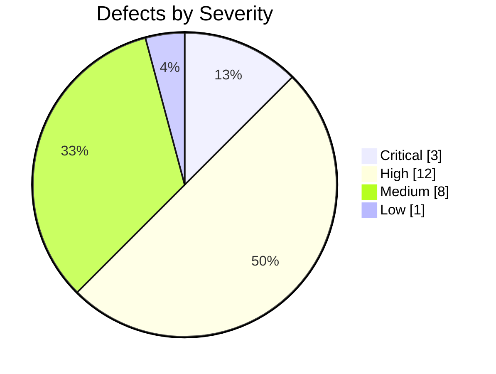

# Task 2: Defect Taxonomy and Verification Logging

## 1. Defect Taxonomy

| Category | Definition | Example |
|---|---|---|
| Ambiguity | A requirement has multiple interpretations. | S5: "any requesting party." |
| Vagueness | A requirement uses unclear terms. | S2: "a large number of boxes." |
| Incompleteness | Necessary information is missing. | S9 does not define low viability. |
| Contradiction | Requirements prescribe conflicting behavior. | S7 conflicts with S8. |
| Non-verifiability | A requirement lacks measurable acceptance criteria. | S12: "good audit trail." |
| Redundancy | Requirements repeat similar information. | S2 and S3 both concern capacity. |
| Infeasibility | A requirement may be impossible under specified conditions. | S7 requires the temperature never to exceed -18°C, even during failures. |
| Untraceability | A requirement lacks a clear link to its source or test. | S6 has no specified verification method. |

## 2. Defect Log

| Defect ID | Req ID | Category | Description | Evidence | Severity | Suggested Fix | Status |
|---|---|---|---|---|---|---|---|
| D01 | S1 | Incompleteness | Registration criteria are undefined. | Registered depositors | Medium | Define registration criteria. | Open |
| D02 | S2 | Vagueness | Capacity is not measurable. | Large number of boxes | High | Specify capacity. | Open |
| D03 | S2, S3 | Redundancy | Capacity requirements overlap. | Both address capacity. | Low | Clarify their relationship. | Open |
| D04 | S3 | Incompleteness | Other chambers are not addressed. | Only Chambers 1-4 are specified. | Medium | Define the complete chamber list. | Open |
| D05 | S3 | Incompleteness | Capacity-counting rules are missing. | Maximum number of boxes | Medium | Define occupancy calculations. | Open |
| D06 | S4 | Incompleteness | Ownership verification is unspecified. | Exactly one depositor | High | Verify ownership before withdrawal. | Open |
| D07 | S4, S5 | Contradiction | Emergency release conflicts with owner-only withdrawal. | Only depositor versus any requesting party | Critical | Define an authorized emergency exception. | Open |
| D08 | S5 | Ambiguity | Emergency conditions are undefined. | In an emergency | High | Define emergency conditions. | Open |
| D09 | S5 | Incompleteness | Requester authorization is unspecified. | Any requesting party | Critical | Verify authority and requester identity. | Open |
| D10 | S5, S12 | Incompleteness | Emergency audit details are unspecified. | Emergency release and all actions | High | Record requester, authority, reason, and time. | Open |
| D11 | S6, S7 | Ambiguity | Safe temperature is undefined in S6. | Safe temperature versus -18°C | High | Define the safe temperature range. | Open |
| D12 | S7, S8 | Contradiction | Maintenance temperature conflicts with the absolute limit. | -18°C versus 0°C | Critical | Define maintenance exceptions and controls. | Open |
| D13 | S7 | Non-verifiability | Monitoring frequency is unspecified. | No sensor criteria | High | Define sensor accuracy and monitoring intervals. | Open |
| D14 | S8 | Incompleteness | Maintenance duration and approval are missing. | During maintenance | High | Define approval and duration. | Open |
| D15 | S9 | Vagueness | Low viability and promptly are undefined. | Low viability; promptly | High | Define threshold and alert deadline. | Open |
| D16 | S9 | Incompleteness | Regeneration responsibility is unspecified. | Flagged for regeneration | Medium | Define responsibility and tracking. | Open |
| D17 | S10 | Ambiguity | Annual period is undefined. | Per year | High | Define calendar year or rolling 12 months. | Open |
| D18 | S10 | Incompleteness | Quota calculation is unclear. | 20% of its boxes | High | Define baseline and rounding rules. | Open |
| D19 | S4, S10 | Incompleteness | Ownership and quota checks are not linked. | Separate withdrawal rules | Medium | Enforce both checks. | Open |
| D20 | S11 | Incompleteness | Re-inspection criteria are undefined. | Re-inspection | Medium | Define inspection and acceptance criteria. | Open |
| D21 | S3, S11 | Incompleteness | Redeposit capacity checks are unspecified. | Capacity and redeposit rules | Medium | Check capacity before redeposit. | Open |
| D22 | S12 | Non-verifiability | Audit quality is not measurable. | Good audit trail | High | Define required audit fields. | Open |
| D23 | S12 | Incompleteness | Audit retention and protection are unspecified. | All actions | High | Define retention and access controls. | Open |
| D24 | S1, S4, S12 | Untraceability | Requirements are not linked to tests. | No traceability matrix | Medium | Link requirements to verification tests. | Open |

## 3. Cross-Requirement Defects

1. S4 and S5: Owner-only withdrawal versus emergency release.
2. S7 and S8: Temperature limit versus maintenance warming.
3. S4 and S10: Ownership authorization versus withdrawal quota.
4. S3 and S11: Chamber capacity versus redeposit.
5. S5 and S12: Emergency release versus audit logging.

## 4. Peer-Review Comparison

| Measurement | Count |
|---|---:|
| Defects in my log (A) | 24 |
| Defects in classmate's log (B) | To be completed |
| Common defects | To be completed |
| Unique defects in combined set | To be completed |
| Additional defects found by classmate | To be completed |

### Missed Defects

| Defect | Requirement | Found By | Reason Missed | Action |
|---|---|---|---|---|
| To be completed | To be completed | Classmate | To be discussed | Added / Rejected |
| To be completed | To be completed | Classmate | To be discussed | Added / Rejected |

### Detection Rate

Detection Rate = (My defects ÷ Unique defects in combined set) × 100%

Example: If my log has 24 unique defects and the union contains 30 unique defects:

Detection Rate = (24 ÷ 30) × 100 = 80%

The final result must use the actual peer-review counts.

## 5. Summary by Severity

| Severity | Count |
|---|---:|
| Critical | 3 |
| High | 12 |
| Medium | 8 |
| Low | 1 |
| Total | 24 |

## 6. Summary by Primary Category

| Category | Count |
|---|---:|
| Ambiguity | 2 |
| Vagueness | 2 |
| Incompleteness | 10 |
| Contradiction | 2 |
| Non-verifiability | 2 |
| Redundancy | 1 |
| Untraceability | 1 |
| Missing authorization rules | 1 |
| Interaction gap | 3 |
| Total | 24 |

## 7. Defect Chart

## 8. Conclusion

The analysis identified 24 candidate defects in the Polar Seed Vault requirements. Major concerns include emergency-release authorization, temperature conflicts, annual withdrawal limits, and auditability.

The requirements should be clarified and made measurable before implementation. Peer review must be completed to identify missed defects and confirm the final detection rate and summary counts.
